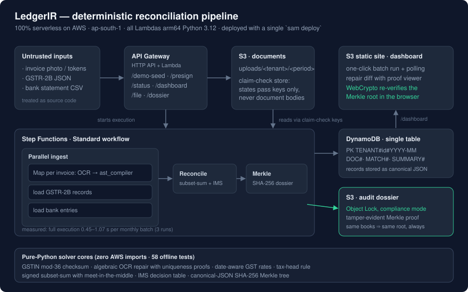

# LedgerIR

**A zero-hallucination financial compiler and constraint-solving engine for Indian
MSMEs** — built for the AWS Builder Center "Weekend Challenge: No Pipeline, No
Problem" (Nov 2026).

**Live demo:** http://ledger-ir-frontendbucket-qjhnf3l9vqvk.s3-website.ap-south-1.amazonaws.com
— one click, no signup. **Write-up:** [WRITEUP.md](WRITEUP.md)

LedgerIR treats messy MSME paperwork — supplier invoice photos, GSTR-2B JSON,
bank statement CSVs — as **untrusted source code** and runs it through a
deterministic compiler pipeline instead of asking a generative model to guess.
No LLMs or managed AI APIs anywhere in the pipeline. Every output is explainable
by a rule or an equation, and every automatic correction ships with a
machine-checkable proof.



## The core ideas

- **Money is integer paise everywhere.** Floats never touch an amount.
- **Two error classes, never mixed:**
  - `OCR_REPAIRED` — *we* misread a character. The repair is accepted only when
    **exactly one** confusion-variant of the low-confidence token satisfies every
    statutory invariant (line math, taxable sum, tax slab, grand total, GSTIN
    checksum). Zero or multiple survivors → `NEEDS_REVIEW`. The proof object
    lists every candidate tried. That uniqueness rule is what makes the
    zero-hallucination claim honest.
  - `SUPPLIER_ERROR` — the *document* is legally wrong (e.g. CGST+SGST charged on
    an interstate supply). A supplier's legal document is never "repaired"; it is
    flagged and drives GST IMS action and an automatic GST payment hold.
- **Lump-sum settlements untangled by search, not vibes:** one NEFT debit is
  matched to a signed subset of invoices (+) and credit notes (−) with
  deterministic tie-breaking — brute force for small candidate pools,
  meet-in-the-middle beyond 20.
- **Tamper-evident audit dossier:** all monthly records are hashed into a
  SHA-256 Merkle tree over canonical JSON; the same input always yields the
  same root.

## Status

**Deployed and running** in `ap-south-1`: SAM stack (S3, DynamoDB single table,
HTTP API, Step Functions Standard, arm64 Python 3.12 Lambdas), S3-hosted
dashboard with in-browser Merkle re-verification, and 58 offline tests. The
measured Step Functions execution for the monthly demo batch is 0.45–1.07 s.

**OCR status, honestly:** the architecture reserves an arm64 container Lambda
running `rapidocr-onnxruntime` as a pure spatial tokenizer. In the current
deployment the demo invoice ships with its precomputed OCR token file (the
exact format the tokenizer emits, including the deliberate low-confidence
misread), and the pipeline's Choice state routes `*_tokens.json` around the OCR
stage; the placeholder OCR Lambda fails loudly rather than pretending.
Everything downstream of tokens is fully real and running.

- [SPEC.md](SPEC.md) — data contracts (JSON Schemas), domain rules, and the
  golden-sample assertions the tests enforce.
- `functions/*/core/` — pure-Python solvers (zero AWS imports, fully unit-tested).
- `sample_data/` — synthetic golden fixtures: a rendered invoice image with one
  genuinely blurred digit and a deliberate tax-head mistake, a GSTR-2B dump, and
  a bank statement whose one NEFT debit settles two bills minus a credit note.
  All GSTINs are synthetic with valid mod-36 checksums; no real business
  identifiers appear anywhere.

## Running the tests

```bash
python3 -m venv .venv
.venv/bin/pip install -r requirements-dev.txt
.venv/bin/python -m pytest
```

To regenerate the sample fixtures deterministically:

```bash
.venv/bin/python scripts/generate_fixtures.py
```

## Repository layout

```
SPEC.md                      # frozen data contracts + domain rules
functions/
  ast_compiler/core/         # tokens -> AST, GSTIN checksum, algebraic OCR repair
  graph_reconciler/core/     # subset-sum matcher, IMS triage, Merkle tree
sample_data/                 # synthetic golden fixtures
scripts/generate_fixtures.py # deterministic fixture generator
tests/                       # golden-sample + robustness suite (pytest)
```
