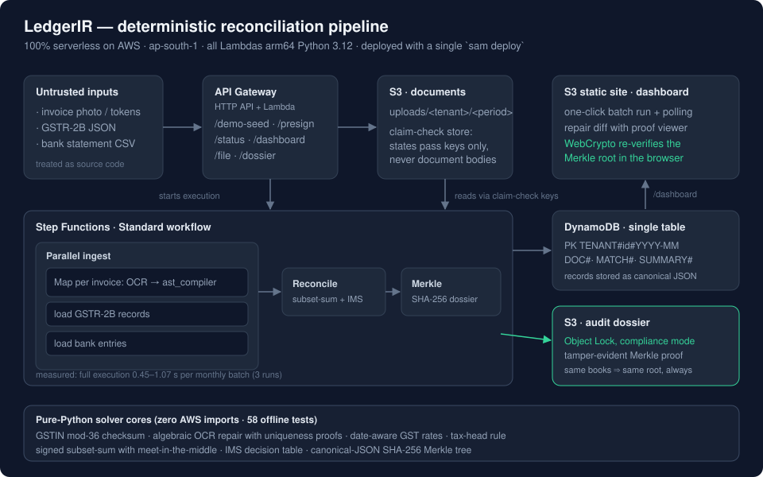

# LedgerIR — a zero-hallucination financial compiler for Indian MSMEs

*Submission for the AWS Builder Center Weekend Challenge: "No Pipeline, No Problem".*

**Demo video:** https://youtu.be/w1FzjysGV60
**Live demo:** https://ledgerir.sumanbiswas.in — one click, no signup, results in seconds.

## The ₹7,200 that almost walked out the door

A fabricator in Kochi buys steel brackets from a supplier in Gujarat. The bill
arrives the way bills actually arrive in India — as a photo taken on a shop
floor. Two things are wrong with it, and nobody in the room can see either one.

First: one digit in a unit price is blurred. OCR reads it as **8** at 62%
confidence, which silently turns a ₹3,000 rate into ₹8,000. Second: the
supplier's accountant charged **CGST+SGST on an interstate sale** — the wrong
tax head. File that as-is and the buyer's ₹7,200 of input tax credit is bad:
under Section 16(2) of the CGST Act, credit only flows when the supplier's
filing matches, the GST IMS regime *deems you to have accepted* invoices you
don't actively reject, and interest on wrongly availed & utilised credit runs
at 18% (as notified; statutory ceiling 24%).

Scale that one bill up: India's ~6 crore registered MSMEs produce roughly
30% of GDP and nearly half of exports, yet most run compliance on WhatsApp
photos, Tally entries keyed in days later, and an accountant who sees the
records weeks after the money moved. When blocked credit squeezes working
capital, the fallback is informal lending at 24–36%.

The fashionable 2026 answer — point an LLM at the documents — is exactly wrong
here. A model that hallucinates one digit in a GSTIN doesn't make a typo; it
files an incorrect statutory return. So LedgerIR uses **no AI at all**.

## The idea: compile the books, don't guess at them

LedgerIR treats paperwork as **untrusted source code**. Documents pass through
a deterministic pipeline — OCR tokens → typed invoice AST → GST rule checks →
subset-sum bank reconciliation → IMS triage → SHA-256 Merkle audit dossier —
and every output is explainable by a rule or an equation. Three design
decisions carry the system:

**1. Two error classes, never mixed.** When a low-confidence token breaks a
statutory invariant (`qty × price = line total`, `Σ lines = taxable`,
`taxable × rate = tax`, GSTIN mod-36 checksum), the compiler enumerates every
confusion-variant of the token (8↔B, 3↔8, 1↔7, …) and repairs **only when
exactly one candidate satisfies every equation**. For the blurred digit above
it tries 8 candidates; one survives — `3,000.00` — and the proof object
listing all 8 ships with the result. Zero or multiple survivors →
`NEEDS_REVIEW`, never a guess. The wrong tax head is the opposite class: a
*supplier's legal document is never altered*. It's flagged `SUPPLIER_ERROR`
and drives a payment hold.

**2. Money is integer paise, everywhere.** No float ever touches an amount, a
rate (basis points), or even a similarity score (also basis points). This
bought an unplanned prize: canonical JSON becomes byte-identical between
Python and JavaScript, so **the dashboard re-verifies the Merkle root in your
browser** — WebCrypto rebuilds all 11 leaf hashes from the records rendered on
the page and recomputes the tree. Your browser independently checks the
server's math.

**3. Determinism as a feature.** Same books ⇒ same root, across reruns *and
across environments*: the root the deployed pipeline computes
(`80ec4eaf…c56e`) is byte-identical to the one the offline test suite derives
from the fixtures. The dossier is sealed under S3 Object Lock in compliance
mode — genuinely undeletable until retention expires — a tamper-evident
"proof of cashflow" an MSME can hand a bank underwriter.

## What one click shows (all real output)

1. **The repair, with its proof.** The blurred digit is repaired `8,000.00 →
   3,000.00` with the full candidate table attached; the wrong tax head is
   *flagged, not fixed*.
2. **One NEFT, three documents.** A single debit of **₹93,220** is matched by
   signed subset-sum search to INV-881 (₹59,000) + INV-883 (₹35,400) − credit
   note CN-12 (₹1,180) — residual **₹0.00**, found among decoy transactions.
3. **Verdicts.** The IMS decision table auto-accepts the three clean settled
   documents and issues `HOLD_GST` on the faulty bill: **₹7,200 held back
   before the money leaves** — the cheapest possible place to catch it,
   45 days before it becomes a tax-filing dispute.
4. **The seal.** The Merkle root appears with a *Re-verify in this browser*
   button; the green stamp means your own machine recomputed it.

And it isn't demo-only: the **"Your own books"** panel gives every visitor a
private per-browser workspace — upload your own GSTR-2B JSON and bank CSV, and
the same pipeline compiles *your* batch in an isolated partition under its own
sealed root. Uploads are locked server-side to each workspace's prefix.

## Measured, not estimated

Every number below is from the deployed system in `ap-south-1`:

| Metric | Measured |
|---|---|
| Step Functions execution, full monthly batch | 0.45 s – 1.07 s (3 runs) |
| Browser click → own batch uploaded, compiled & sealed | 2.1 s |
| Offline test suite (zero AWS dependencies) | 58 tests, green |
| Merkle root, cloud vs. offline test suite | byte-identical |
| Browser re-verification | 11 leaves recomputed, roots match, 0 console errors |
| Idle cost | ~zero (on-demand DynamoDB, no provisioned anything) |

## Architecture

| Subsystem | Service | Pattern |
|---|---|---|
| Documents & dossier vault | S3 (+ Object Lock) | claim-check store; write-once audit proofs |
| Ingestion & query API | API Gateway HTTP API | presigned uploads, demo seeder, dashboard reads |
| Orchestration | Step Functions Standard | Parallel(Map compile \| 2B \| bank) → Reconcile → Merkle; states carry S3 keys only |
| Solvers | Lambda arm64 / Python 3.12 | pure-Python cores with zero AWS imports |
| State | DynamoDB single table | one partition per tenant-month; records stored as canonical JSON |
| IaC | AWS SAM | one `sam build && sam deploy` from a laptop — no pipeline, no problem |

Serverless isn't incidental: an MSME's batch is tiny and monthly, so the
system idles at effectively zero cost and scales per-invoice when the month
closes.

## Craft & honesty notes

- The JSON Schemas are extracted from SPEC.md itself by the test suite, so the
  spec is machine-checked against the fixtures and the solvers.
- **OCR status, honestly:** the architecture reserves an arm64 container
  Lambda running `rapidocr-onnxruntime` as a pure spatial tokenizer. In this
  deployment the demo invoice ships with its precomputed token file (the exact
  format the tokenizer emits, including the deliberate 62%-confidence
  misread), and the pipeline's Choice state routes `*_tokens.json` around the
  OCR stage; the placeholder OCR Lambda fails loudly rather than pretending.
  Everything downstream of tokens — where the novel claims live — is fully
  real and running.
- **All data is synthetic.** GSTINs carry valid mod-36 checksums but belong to
  no real business; parties, amounts and bank rows are invented.

LedgerIR is a financial compiler, not a chatbot: every number explainable,
every fix proven, every month sealed.
